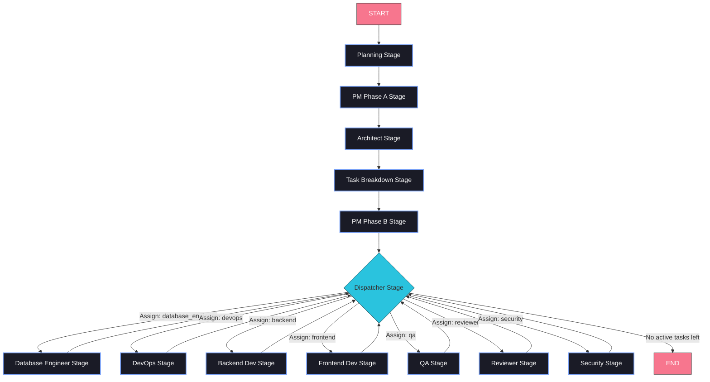
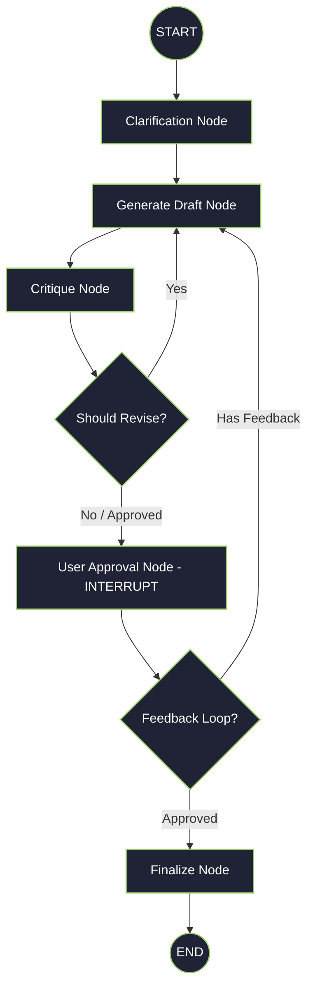
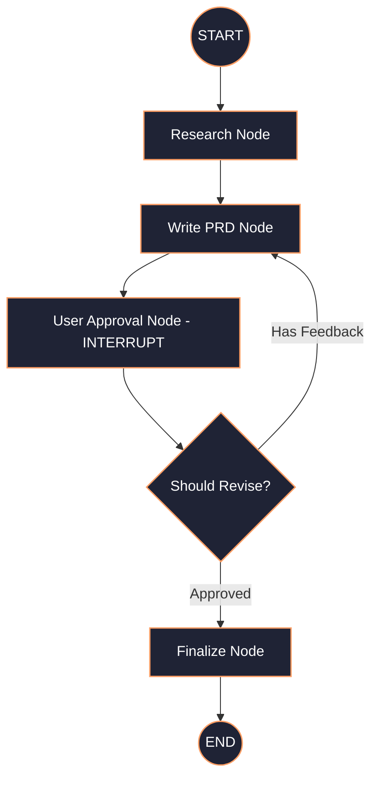
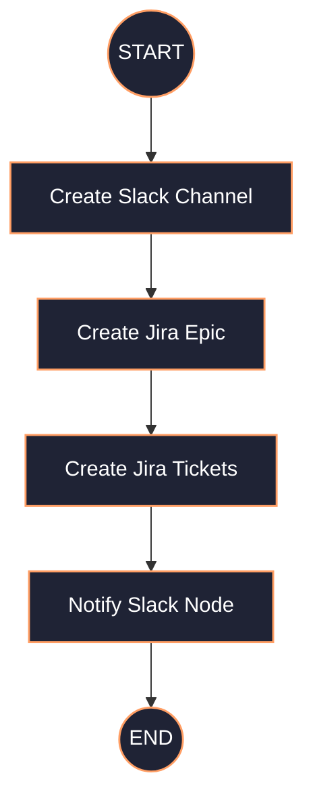
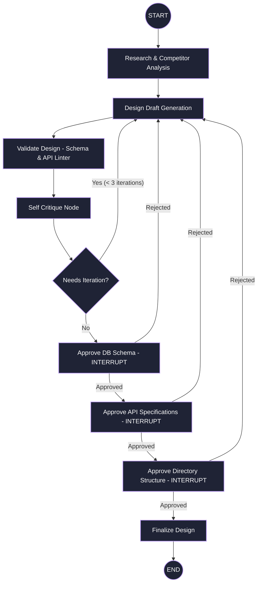
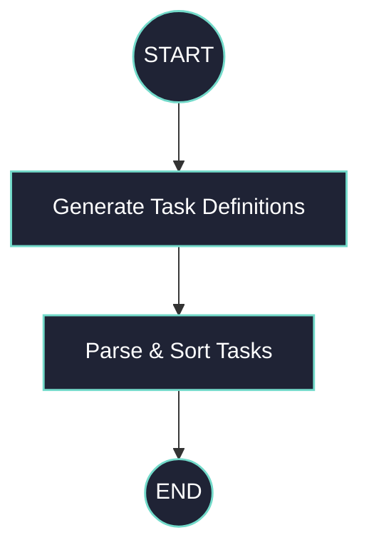
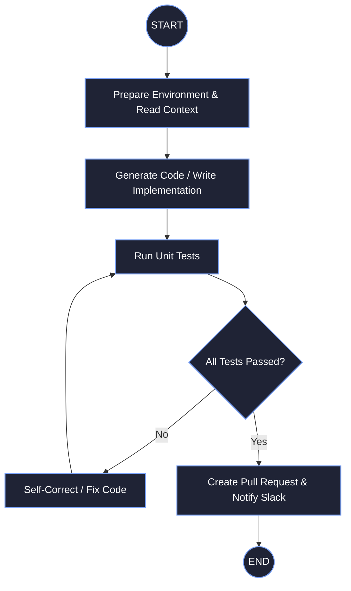

# SDLC Orchestrator Architecture Overview

This document presents the complete graph architecture of the SDLC Orchestrator, highlighting both the parent orchestrator loop and the individual subgraphs that execute within each stage.

---

## 1. Parent Orchestrator Graph

The parent orchestrator guides the project execution linearly through setup phases (Requirements Definition, PRD Creation, System Architecture Design, and Task Breakdown) before entering the **Dispatcher Loop** to orchestrate agent tasks.

---

## 2. Subgraph Workflows

Each wrapper stage in the parent orchestrator executes an isolated LangGraph subgraph using context-specific states and custom checkpointers. Below is the detailed breakdown of the subgraphs.

### A. Planning Subgraph
Processes the initial user requirements, clarifies ambiguities, and produces a structured feasibility plan.

### B. Product Manager Subgraphs
Divided into Phase A (PRD creation & review) and Phase B (Jira & Slack initial setup).

#### PM Phase A (PRD Creation)

#### PM Phase B (Platform Setup)

---

### C. Architect Subgraph
Generates system designs, validates database schemas, and contains sequential human-in-the-loop checkpoints for Schema, API, and directory layouts.

---

### D. Task Breakdown Subgraph
Parses the finalized PRD and Design Document to generate discrete tickets mapped to specific SDLC roles with dependency trees.

---

### E. Developer & QA Subgraphs (Agent Executors)
When the Dispatcher hands a task to a developer role (e.g. `backend`, `frontend`, `database_engineer`), the execution subgraph runs the development lifecycle loop.

