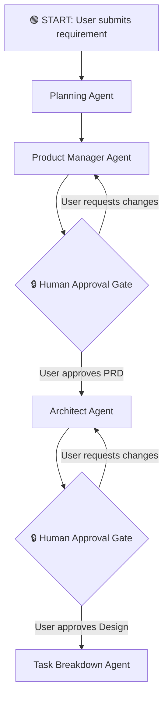
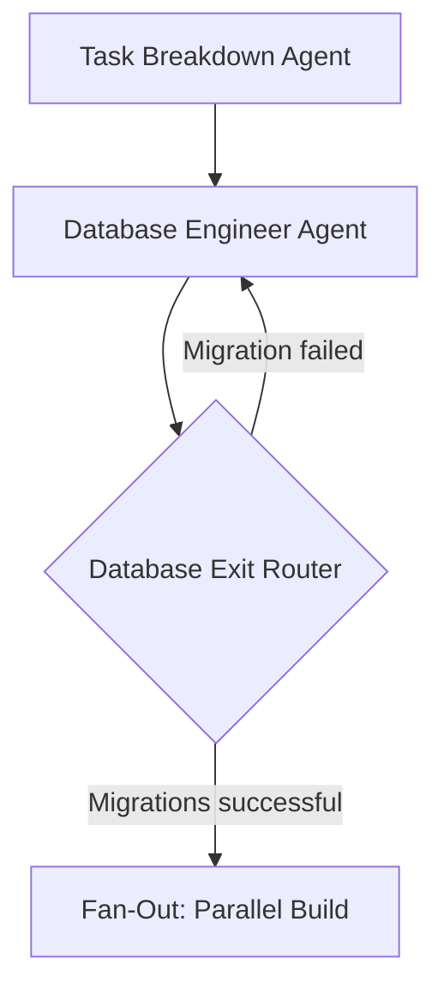
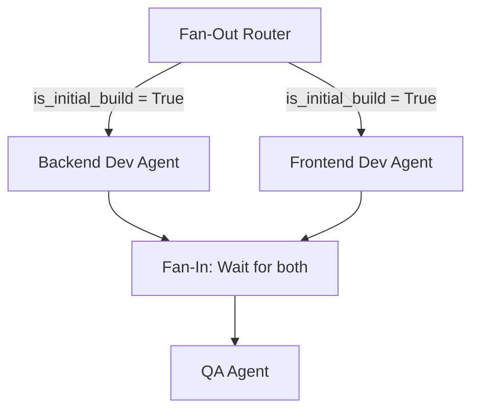
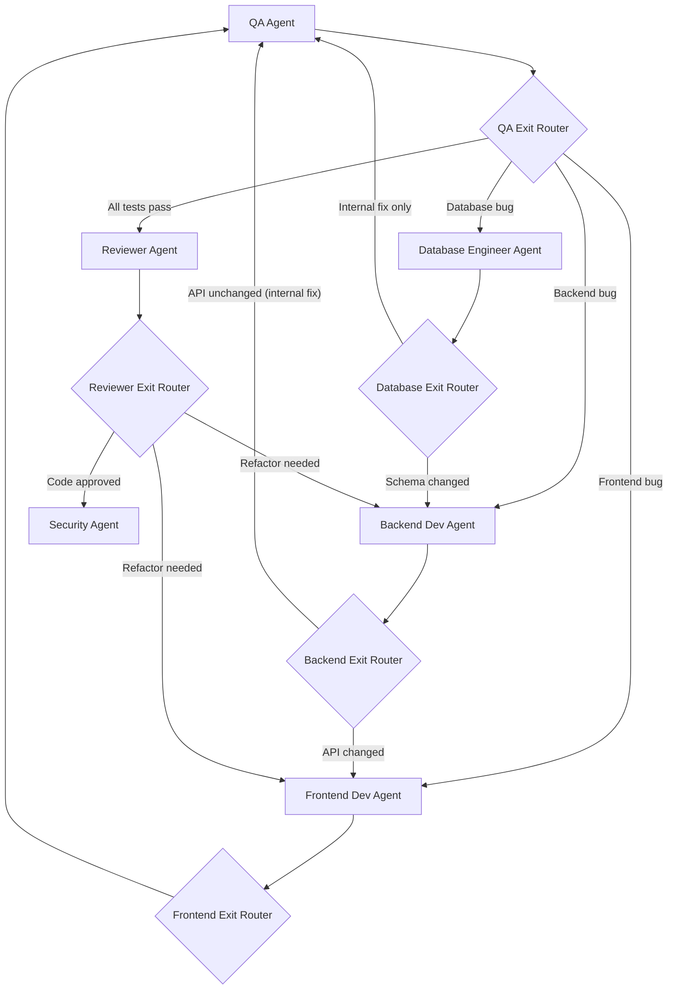
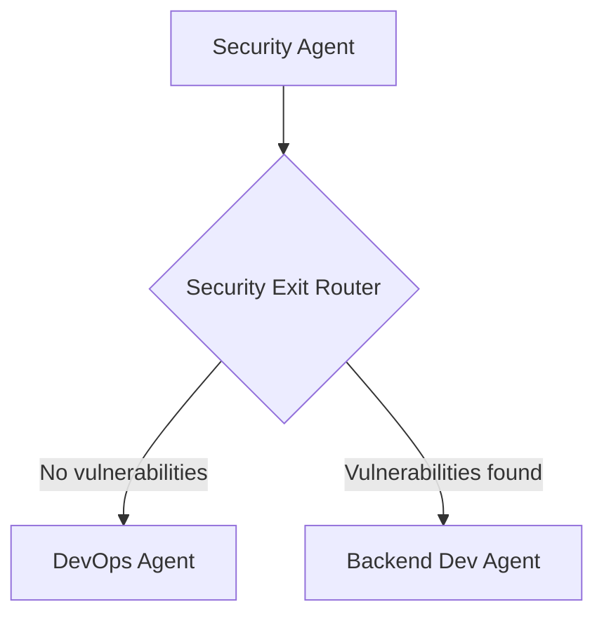
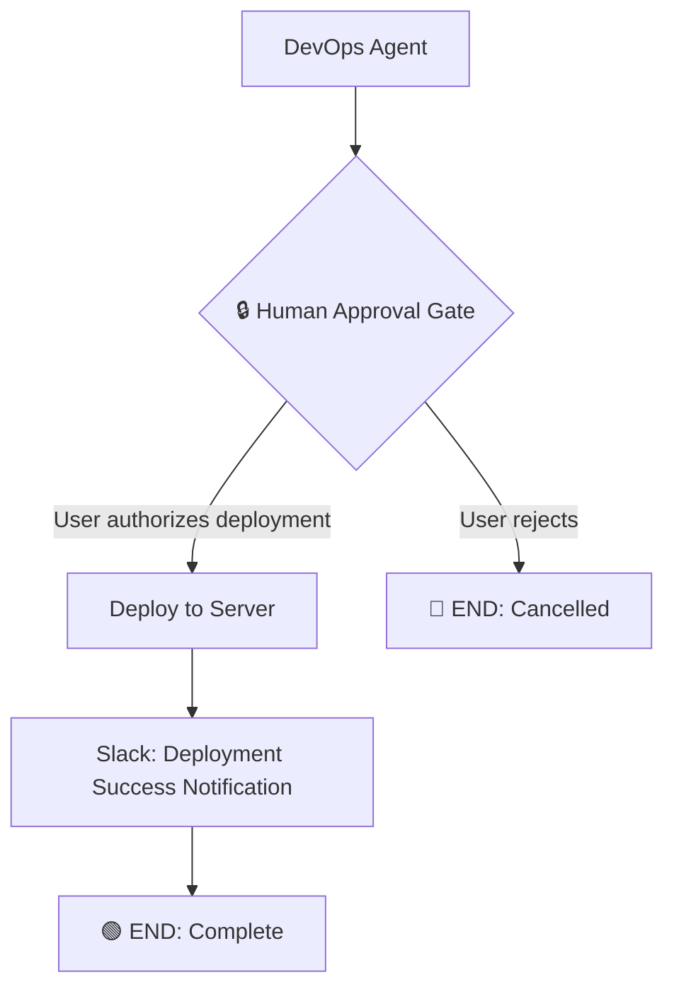
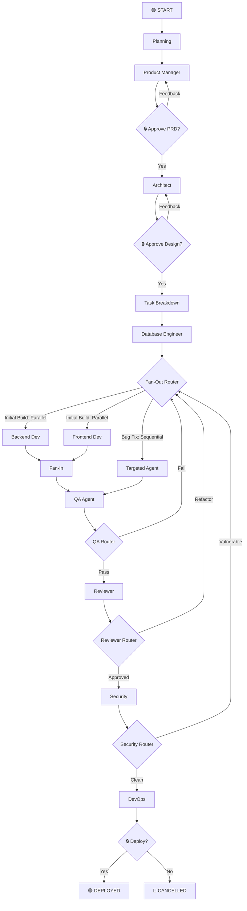

# Multi-Agent SDLC — Complete Pipeline Flow

## Overview

This document describes the end-to-end execution flow of the Multi-Agent SDLC platform, covering every agent, every router, every conditional edge, and every feedback loop from user input to final deployment.

---

## Phase 1: Requirements & Planning (Sequential)

### Step-by-step:

| Step | Agent | Input | Output | Notes |
|------|-------|-------|--------|-------|
| 1 | **Planning Agent** | `user_req` | Initial feasibility analysis, scope definition | First contact with the raw requirement |
| 2 | **Product Manager Agent** | `user_req` | PRD (Product Requirements Document) | Strictly business: user stories, acceptance criteria, KPIs |
| 3 | **🔒 Human Approval Gate** | PRD displayed in Next.js UI | User clicks Approve or sends feedback | If feedback → loops back to PM with changes |
| 4 | **Architect Agent** | `user_req` + approved PRD | System Design Document (schemas, APIs, file tree) | Strictly technical: database tables, endpoints, architecture |
| 5 | **🔒 Human Approval Gate** | Design Doc displayed in UI | User clicks Approve or sends feedback | If feedback → loops back to Architect |
| 6 | **Task Breakdown Agent** | `final_design_doc` | JSON array of atomic, sequenced tasks with role assignments | Each task tagged with `assigned_to` and `target_files` |

> [!IMPORTANT]
> The Planning agents have **no code-writing tools**. They only have access to RAG search and optionally web search. Their sole output is markdown documents and JSON plans written to the state.

---

## Phase 2: Database Foundation (Sequential, Blocking)

### Step-by-step:

| Step | Agent | Input | Output | Notes |
|------|-------|-------|--------|-------|
| 7 | **Database Engineer Agent** | `final_design_doc` + tasks filtered to `database_engineer` | `db_schema_changes` (migration scripts, ORM models) | Has SQL execution tools, Alembic tools |
| 8 | **Database Exit Router** | Checks if migrations ran successfully | Routes to parallel build or loops back | The DB must be ready before any developer writes ORM code |

> [!WARNING]
> The Database Engineer runs **before** the Backend and Frontend agents. This is a hard dependency. If the schema is not ready, the backend ORM code will fail.

---

## Phase 3: Parallel Build (Fan-Out)

### Step-by-step:

| Step | Agent | Input | Output | Notes |
|------|-------|-------|--------|-------|
| 9a | **Backend Dev Agent** | `final_design_doc` + tasks filtered to `backend_dev` + `agent_logs` | `backend_file_changes` | Writes Python/FastAPI code to sandbox. Has file read/write tools scoped to `/backend` |
| 9b | **Frontend Dev Agent** | `final_design_doc` + tasks filtered to `frontend_dev` + `agent_logs` | `frontend_file_changes` | Writes React/Next.js code to sandbox. Has file read/write tools scoped to `/frontend` |
| 10 | **Fan-In** | Waits for both 9a and 9b to complete | Merges all file changes into `final_file_changes` in global state | The graph does not proceed until both agents signal completion |

> [!NOTE]
> During the initial parallel build, the Frontend Agent builds against the **Architect's API contract** (mock data). It trusts that the Backend Agent is implementing the same contract simultaneously.

---

## Phase 4: Quality Assurance & Review (Sequential, with Feedback Loops)

### Step-by-step:

| Step | Agent | Input | Output | Notes |
|------|-------|-------|--------|-------|
| 11 | **QA Agent** | `final_file_changes` + `final_design_doc` | Structured JSON bug report (`status`, `faulty_component`, `requires_api_change`) | Reads actual code files, writes test scripts, runs `pytest`/`npm test` |
| 12 | **QA Exit Router** | Reads QA structured output | Routes to Reviewer (pass) or to the faulty agent (fail) | Simple `if/else` on the `faulty_component` field |
| 13 | **Backend Exit Router** | Reads backend's `api_changed` flag from structured output | Routes to Frontend (if API changed) or QA (if internal fix) | Prevents frontend from running on stale API contracts |
| 14 | **Frontend Exit Router** | Frontend finishes fix | Always routes back to QA for re-testing | Frontend fixes never ripple upstream |
| 15 | **Database Exit Router** | Reads if schema was modified | Routes to Backend (if schema changed) or QA (if internal fix) | Schema changes force backend ORM updates |
| 16 | **Reviewer Agent** | `final_file_changes` + `final_design_doc` + `workflow_tasks` | Approval or refactor instructions | Static analysis: code quality, architecture compliance, naming conventions |
| 17 | **Reviewer Exit Router** | Reads reviewer's verdict | Routes to Security (approved) or back to developers (refactor needed) | |

> [!IMPORTANT]
> During bug-fix iterations, `is_initial_build` is set to `False`. The Fan-Out Router now routes **sequentially** based on the QA bug report instead of launching both developers in parallel.

---

## Phase 5: Security Audit (Sequential)

### Step-by-step:

| Step | Agent | Input | Output | Notes |
|------|-------|-------|--------|-------|
| 18 | **Security Agent** | `final_file_changes` + `final_design_doc` | Vulnerability report (SQL injection, XSS, hardcoded secrets, etc.) | Scans the actual code for security anti-patterns |
| 19 | **Security Exit Router** | Reads vulnerability report | Routes to DevOps (clean) or back to developers (fix needed) | |

---

## Phase 6: Deployment (Sequential, Final)

### Step-by-step:

| Step | Agent | Input | Output | Notes |
|------|-------|-------|--------|-------|
| 20 | **DevOps Agent** | `final_file_changes` + `final_design_doc` | Dockerfile, CI/CD pipeline config, deployment scripts | Has Docker tools, GitHub Actions tools |
| 21 | **🔒 Human Approval Gate** | Deployment plan displayed in UI | User authorizes or rejects | Final safety net before production |
| 22 | **Deploy** | Executes deployment scripts | Application live on server | |
| 23 | **Slack Notification** | Deployment result | Posts to `#deployments` channel | |

---

## Complete End-to-End Graph

---

## Router Summary Table

| Router | Location | Decision Logic | Possible Routes |
|--------|----------|----------------|-----------------|
| **Fan-Out Router** | After Database Engineer | Checks `is_initial_build` flag | Parallel (Backend + Frontend) or Sequential (targeted agent) |
| **Database Exit Router** | After Database Engineer fix | Checks if schema was modified | Backend (schema changed) or QA (internal fix) |
| **Backend Exit Router** | After Backend Dev fix | Checks `api_changed` flag in structured output | Frontend (API changed) or QA (internal fix) |
| **Frontend Exit Router** | After Frontend Dev fix | Always re-test | QA |
| **QA Exit Router** | After QA Agent | Reads `faulty_component` from structured JSON output | Reviewer (pass), Backend/Frontend/DB (fail) |
| **Reviewer Exit Router** | After Reviewer Agent | Reads approval verdict | Security (approved) or Developers (refactor) |
| **Security Exit Router** | After Security Agent | Reads vulnerability report | DevOps (clean) or Developers (fix) |

---

## Communication Channels

| Channel | Mechanism | When |
|---------|-----------|------|
| **Agent → Agent** | `agent_logs` in global state (via wrapper nodes) | Every agent appends structured logs after completing work |
| **Agent → Human (UI)** | WebSocket via FastAPI + Redis Pub/Sub | Real-time streaming of agent progress to Next.js dashboard |
| **Agent → Human (Slack)** | Slack Webhook / Slack Bot MCP | Approval gates, deadlocks, deployment notifications |
| **Human → Agent** | LangGraph HITL pause/resume | User injects feedback at approval gates via UI or Slack |
| **State Persistence** | PostgreSQL Checkpointer (`AsyncPostgresSaver`) | Every node completion auto-saves state to `agenticdb` |
