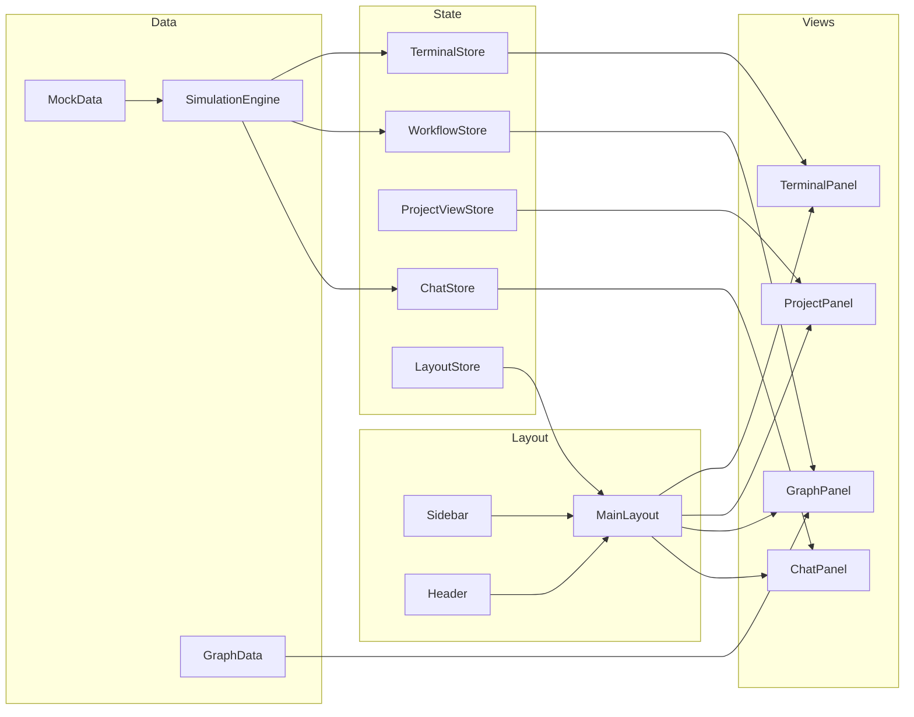

# Multi-Agent SDLC Frontend — Implementation Walkthrough

## What Was Built

A premium, interactive Next.js frontend dashboard for the Multi-Agent SDLC Orchestrator with four core panels: **Chat Interface**, **Graph Visualization**, **Project Viewer**, and **Terminal** — all unified under a charcoal/black/gray design system.

---

## Architecture Summary

---

## Key Features Implemented

### 1. Chat Interface
- **Streaming messages**: Token-by-token text animation with blinking cursor
- **Agent states**: Animated indicators (🧠 Thinking, 📝 Drafting, ⏳ Awaiting Approval)
- **Approval cards**: Inline approve/reject buttons with expandable feedback textarea
- **Markdown rendering**: Full GFM support for PRDs and design docs in chat
- **Auto-scroll**: New messages automatically scroll into view

### 2. Graph Visualization
- **Parent graph**: Full SDLC orchestrator pipeline (15 nodes, all agents)
- **Active subgraph**: Split view showing the running agent's internal workflow
- **Animated nodes**: Glow effects for running nodes, checkmarks for completed
- **Animated edges**: Flowing animations on active connections
- **Minimap + controls**: Zoom, pan, fit-to-view

### 3. Project Viewer
- **File tree**: Collapsible directories with language-specific icons (TS, Python, JSON, etc.)
- **Code viewer**: Syntax-highlighted with line numbers and copy button
- **Diff viewer**: Side-by-side git diff with additions (green) / deletions (red)
- **Document viewer**: Markdown PRDs and design docs with status badges
- **Tab bar**: VS Code-style tabs for open files

### 4. Terminal
- **Multiple sessions**: Tabs per agent (Orchestrator, Backend Dev)
- **Color-coded output**: Commands (blue), success (green), errors (red), info (cyan)
- **Auto-scroll**: Real-time output scrolling
- **Collapsible**: Toggle visibility via sidebar or panel header

### 5. Layout & Navigation
- **Slim icon sidebar**: 56px wide with tooltips and active indicators
- **Resizable panels**: Draggable divider between chat and graph
- **View modes**: Workspace (chat+graph), Project Files, Documents
- **Pipeline progress bar**: Real-time progress indicator in header

---

## Files Created / Modified

### New Files (31 files)

| Category | File | Description |
|----------|------|-------------|
| **Types** | [chat.ts](file:///c:/Users/Orax%20Technologies/Desktop/hamza_sdlc/frontend/src/types/chat.ts) | Chat message, approval, streaming types |
| **Types** | [terminal.ts](file:///c:/Users/Orax%20Technologies/Desktop/hamza_sdlc/frontend/src/types/terminal.ts) | Terminal session and line types |
| **Stores** | [chatStore.ts](file:///c:/Users/Orax%20Technologies/Desktop/hamza_sdlc/frontend/src/store/chatStore.ts) | Chat messages, agent state, approvals |
| **Stores** | [projectViewStore.ts](file:///c:/Users/Orax%20Technologies/Desktop/hamza_sdlc/frontend/src/store/projectViewStore.ts) | File tree, tabs, diff, documents |
| **Stores** | [terminalStore.ts](file:///c:/Users/Orax%20Technologies/Desktop/hamza_sdlc/frontend/src/store/terminalStore.ts) | Terminal sessions and output |
| **Stores** | [layoutStore.ts](file:///c:/Users/Orax%20Technologies/Desktop/hamza_sdlc/frontend/src/store/layoutStore.ts) | Panel sizes, view modes |
| **Hooks** | [useStreamingText.ts](file:///c:/Users/Orax%20Technologies/Desktop/hamza_sdlc/frontend/src/hooks/useStreamingText.ts) | Token-by-token text streaming |
| **Hooks** | [usePanelResize.ts](file:///c:/Users/Orax%20Technologies/Desktop/hamza_sdlc/frontend/src/hooks/usePanelResize.ts) | Draggable panel resizer |
| **Hooks** | [useWebSocket.ts](file:///c:/Users/Orax%20Technologies/Desktop/hamza_sdlc/frontend/src/hooks/useWebSocket.ts) | Mock WebSocket (ready for backend swap) |
| **Data** | [graphData.ts](file:///c:/Users/Orax%20Technologies/Desktop/hamza_sdlc/frontend/src/lib/graphData.ts) | Parent + subgraph node/edge definitions |
| **Data** | [mockData.ts](file:///c:/Users/Orax%20Technologies/Desktop/hamza_sdlc/frontend/src/lib/mockData.ts) | Chat messages, file tree, diffs, terminals |
| **Data** | [simulateWorkflow.ts](file:///c:/Users/Orax%20Technologies/Desktop/hamza_sdlc/frontend/src/lib/simulateWorkflow.ts) | Timed simulation engine |
| **Chat** | [ChatPanel.tsx](file:///c:/Users/Orax%20Technologies/Desktop/hamza_sdlc/frontend/src/components/chat/ChatPanel.tsx) | Main chat container |
| **Chat** | [ChatMessage.tsx](file:///c:/Users/Orax%20Technologies/Desktop/hamza_sdlc/frontend/src/components/chat/ChatMessage.tsx) | Message bubble with markdown + streaming |
| **Chat** | [ChatInput.tsx](file:///c:/Users/Orax%20Technologies/Desktop/hamza_sdlc/frontend/src/components/chat/ChatInput.tsx) | Auto-resize input with send button |
| **Chat** | [AgentStateIndicator.tsx](file:///c:/Users/Orax%20Technologies/Desktop/hamza_sdlc/frontend/src/components/chat/AgentStateIndicator.tsx) | Animated state chips |
| **Chat** | [ApprovalCard.tsx](file:///c:/Users/Orax%20Technologies/Desktop/hamza_sdlc/frontend/src/components/chat/ApprovalCard.tsx) | Inline approve/reject with feedback |
| **Graph** | [GraphPanel.tsx](file:///c:/Users/Orax%20Technologies/Desktop/hamza_sdlc/frontend/src/components/graph/GraphPanel.tsx) | ReactFlow parent + subgraph split |
| **Project** | [ProjectPanel.tsx](file:///c:/Users/Orax%20Technologies/Desktop/hamza_sdlc/frontend/src/components/project/ProjectPanel.tsx) | Full project viewer container |
| **Project** | [FileTree.tsx](file:///c:/Users/Orax%20Technologies/Desktop/hamza_sdlc/frontend/src/components/project/FileTree.tsx) | Collapsible file explorer |
| **Project** | [CodeViewer.tsx](file:///c:/Users/Orax%20Technologies/Desktop/hamza_sdlc/frontend/src/components/project/CodeViewer.tsx) | Syntax-highlighted code display |
| **Project** | [DiffViewer.tsx](file:///c:/Users/Orax%20Technologies/Desktop/hamza_sdlc/frontend/src/components/project/DiffViewer.tsx) | Git-style diff comparison |
| **Project** | [DocumentViewer.tsx](file:///c:/Users/Orax%20Technologies/Desktop/hamza_sdlc/frontend/src/components/project/DocumentViewer.tsx) | Markdown document renderer |
| **Terminal** | [TerminalPanel.tsx](file:///c:/Users/Orax%20Technologies/Desktop/hamza_sdlc/frontend/src/components/terminal/TerminalPanel.tsx) | Terminal with session tabs |

### Modified Files (8 files)

| File | Changes |
|------|---------|
| [globals.css](file:///c:/Users/Orax%20Technologies/Desktop/hamza_sdlc/frontend/src/app/globals.css) | Complete charcoal design system (~450 lines) |
| [layout.tsx](file:///c:/Users/Orax%20Technologies/Desktop/hamza_sdlc/frontend/src/app/layout.tsx) | Inter + JetBrains Mono fonts, SEO metadata |
| [agent.ts](file:///c:/Users/Orax%20Technologies/Desktop/hamza_sdlc/frontend/src/types/agent.ts) | Agent states, roles, display metadata |
| [workflow.ts](file:///c:/Users/Orax%20Technologies/Desktop/hamza_sdlc/frontend/src/types/workflow.ts) | Subgraph definitions, ReactFlow positions |
| [project.ts](file:///c:/Users/Orax%20Technologies/Desktop/hamza_sdlc/frontend/src/types/project.ts) | FileNode, FileDiff, ProjectDocument types |
| [workflowStore.ts](file:///c:/Users/Orax%20Technologies/Desktop/hamza_sdlc/frontend/src/store/workflowStore.ts) | Active node tracking, subgraph state |
| [Sidebar.tsx](file:///c:/Users/Orax%20Technologies/Desktop/hamza_sdlc/frontend/src/components/layout/Sidebar.tsx) | Slim icon sidebar with tooltips |
| [Header.tsx](file:///c:/Users/Orax%20Technologies/Desktop/hamza_sdlc/frontend/src/components/layout/Header.tsx) | Progress bar, agent state, connection status |
| [MainLayout.tsx](file:///c:/Users/Orax%20Technologies/Desktop/hamza_sdlc/frontend/src/components/layout/MainLayout.tsx) | Multi-panel workspace with resizable panels |
| [page.tsx](file:///c:/Users/Orax%20Technologies/Desktop/hamza_sdlc/frontend/src/app/dashboard/page.tsx) | Simulation-driven workspace entry point |

---

## Verification

| Check | Result |
|-------|--------|
| `npm run build` | ✅ Compiled successfully in 3.9s, 0 TypeScript errors |
| Visual verification | ✅ All panels render correctly |
| Chat streaming | ✅ Messages appear with token-by-token animation |
| Graph nodes | ✅ Animate through pending → running → completed |
| Approval cards | ✅ Approve/reject buttons render in chat flow |
| Terminal output | ✅ Color-coded, auto-scrolling terminal |
| Panel resizing | ✅ Draggable divider between chat and graph |
| View switching | ✅ Workspace / Project / Docs views work |

---

## Next Steps

> [!TIP]
> The frontend is fully built with mock data. To connect to the real backend:

1. **WebSocket Integration**: Replace `useWebSocket.ts` mock with real FastAPI WebSocket connection at `/ws/workflow/{id}`
2. **Backend API Routes**: Add REST endpoints for project listing, file retrieval, and approval submission
3. **Redis Pub/Sub**: Connect the simulation engine to real Redis-streamed agent events
4. **LangGraph HITL**: Wire approval cards to the `Command(resume=...)` pattern in the orchestrator
